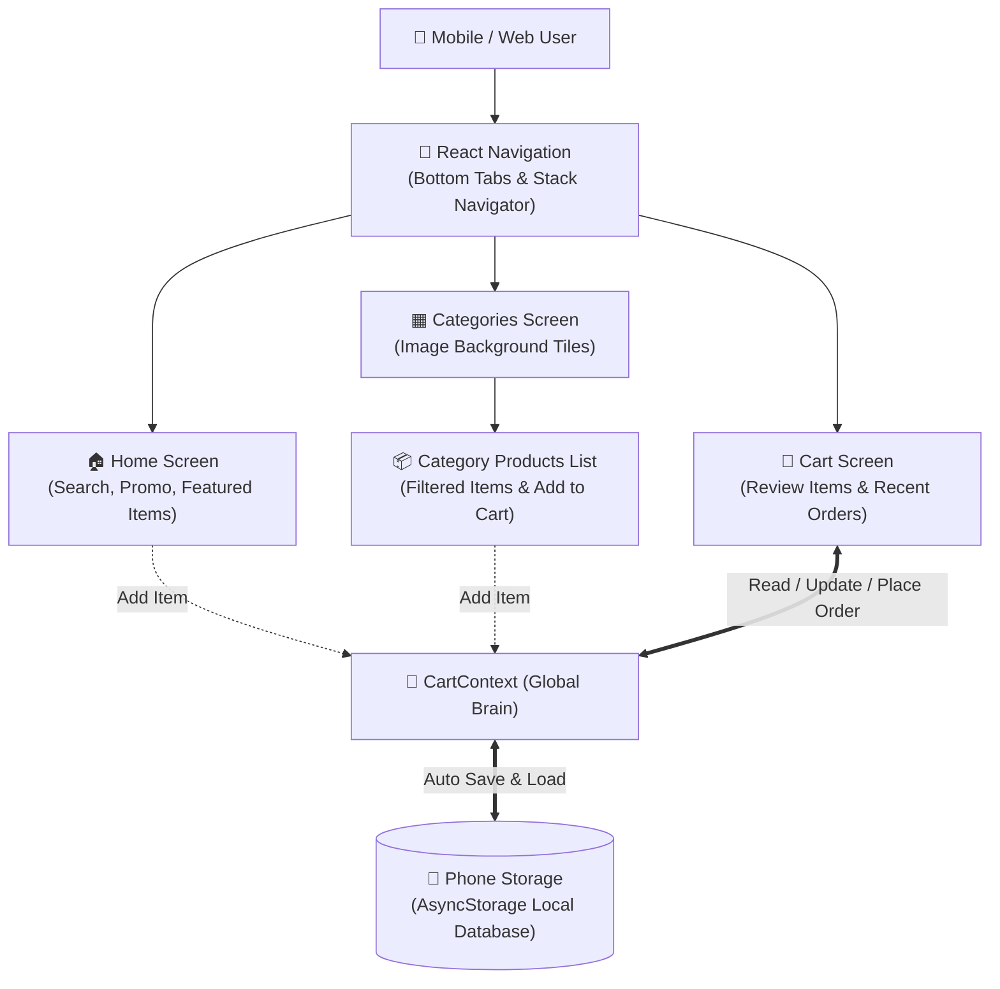

# 01. Project Overview & Architecture Guide 📱🛒

Yeh document **MyShoppy** project ka high-level overview aur technical architecture ek simple, layman-friendly bhasha mein explain karta hai. Agar koi non-technical person ya interviewer aapse project ke baare mein puche, toh yeh document aapko pura flow samjha dega.

---

## 1. Project Kya Hai? (In Simple Words)

**MyShoppy** ek modern, fast aur user-friendly mobile e-commerce application hai. 
Iska main maqsad users ko ek clean shopping experience dena hai jahan wo:
- Alag-alag categories (Electronics, Furniture, Bags, Books, Sneakers, Clothes) browse kar sakein.
- Products search kar sakein aur cart mein add kar sakein.
- Cart ke andar quantity badha ya ghata sakein.
- Order place karne ke baad apni **Recent Orders** history dekh sakein.

Yeh app **Android**, **iOS**, aur **Web Browser** teeno platforms par bina kisi badlaav ke chalta hai (Cross-Platform).

---

## 2. Tech Stack (Kon-Konsi Technologies Use Hui Hain?)

Har technical term ko simple layman bhasha mein samjhein:

| Technology | Asli Kaam (Role) | Layman Explanation (Aasan Bhasha Mein) |
| :--- | :--- | :--- |
| **React Native** | Core Framework | Ek aisi technology jisse hum JavaScript likh kar real Android aur iOS mobile apps banate hain. |
| **Expo** | Development Toolset | React Native ka helper tool jo camera, fonts, icons aur app building ko aasan aur fast banata hai. |
| **React Navigation** | App Navigation | Ek screen se doosri screen par jane (jaise Home se Categories ya Cart) ka rasta/traffic controller. |
| **Context API** | Global State Manager | Ek central memory box jahan cart ke items aur orders ka data rehta hai, taaki har screen us data ko dekh sake. |
| **AsyncStorage** | Local Database | Mobile phone ki local memory (pen-drive ki tarah), jisse app band hone ke baad bhi cart aur orders delete nahi hote. |
| **@expo/vector-icons** | Modern Icons | Professional icons (Cart, Home, Grid, Heart, Search) jo app ko sundar aur modern banate hain. |

---

## 3. System Architecture Diagram

Niche diye gaye diagram mein dekhein ki app ke saare parts aapas mein kaise jude hue hain:



---

## 4. Folder Structure (Files Kahan Par Hain?)

Project ka folder structure bohot clean aur organized hai:

```text
MyShoppy/
├── App.js                  # Main entry point jahan Bottom Tabs aur Navigation define hain
├── package.json            # Project dependencies aur start commands ki list
├── app.json                # Expo configuration file (app name, icons, splash screen)
│
├── documents/              # Project Documentation & Viva Guides (Yeh folder)
│
└── src/
    ├── constants/
    │   └── theme.js        # Saare colors, borders, shadows aur spacing ke design tokens
    │
    ├── context/
    │   └── CartContext.js  # Global memory jo Cart aur Orders ko handle karti hai
    │
    ├── data/
    │   ├── categories.json # Saari 6 categories ka data aur unke image links
    │   └── products.json   # Saare 40+ products, unke prices aur categories
    │
    ├── screens/
    │   ├── HomeScreen.js       # Discovery feed, search, aur featured products
    │   ├── CategoriesTiles.js  # 2-column image tile categories screen
    │   ├── CategoryItems.js    # Selected category ke products aur popup modal
    │   └── CartItems.js        # Cart management aur Recent Orders display
    │
    └── utils/
        └── format.js       # Indian Rupee (₹) price formatting helper
```

---

## 5. Technical Terms Ka Layman Dictionary

Agar viva ya discussion mein yeh words aayein, toh unka matlab yeh hota hai:

- **Component**: Screen ka koi bhi chhota ya bada hissa (jaise Button, Search Bar, ya pura Product Card). Jaise LEGO blocks jud kar ghar banate hain, waise components jud kar app banate hain.
- **State**: Screen par jo data waqt ke saath badal sakta hai (jaise cart mein items ka count `0` se `3` hona).
- **Props**: Ek parent component se doosre child component ko data bhejna (jaise Category ka naam next screen ko pass karna).
- **Hooks (`useState`, `useContext`, `useEffect`)**: React ke special tools jo screen par data save karne, data update hone par screen redraw karne, aur memory load karne mein help karte hain.
- **AsyncStorage**: Phone ki storage jahan JSON format mein string data save hota hai.
