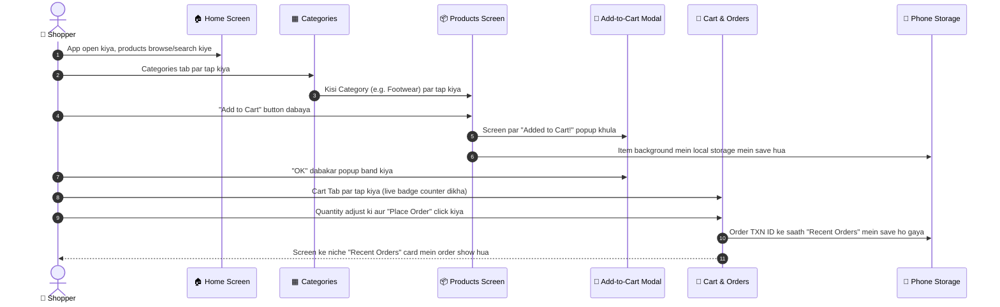

# 02. How It Works & Key Features Guide 🔍🛍️

Yeh document **MyShoppy** app ke saare features, screens aur data flow ko step-by-step explain karta hai. Har screen par kya hota hai aur peeche code kaise kaam kar raha hai, yeh yahan aasan shabdon mein likha gaya hai.

---

## 1. End-to-End User Shopping Flow

Yeh diagram dikhata hai ki ek aam user shuru se aakhir tak app ko kaise use karta hai:

---

## 2. Screen-by-Screen Detailed Working

### A. Home Screen (`src/screens/HomeScreen.js`)
Home screen app ka **Discovery Engine** hai:
1. **Top Brand Bar**: 
   - Left side par bold `MyShoppy` brand title aur tagline.
   - Right side par Cart shortcut button jiske upar **live count badge** laga hai.
2. **Live Search Bar**:
   - User jaise hi product ka naam ya category likhta hai, niche ke products instantly filter ho jate hain.
   - Text mitane ke liye 1-tap clear (`X`) button hai.
3. **Hero Editorial Banner**:
   - Slate dark background wala premium banner jo special offers promote karta hai aur "Browse All Categories" ka shortcut deta hai.
4. **Quick Category Pills**:
   - Horizontal scrollable buttons jisse user bina Categories page par jaye seedhe filter kar sakta hai.
5. **Featured Products Grid**:
   - 2-column grid jisme product image, category tag, naam, price (`₹`), aur 1-tap "Add" button hai.

---

### B. Categories Screen (`src/screens/CategoriesTiles.js`)
Is screen ka design authentic e-commerce tiles par based hai:
1. **Full-Bleed Image Background Tiles**:
   - Har category (Electronics, Furniture, Bags, Books, Sneakers, Clothes) ek large rounded card (`borderRadius: 18`) mein render hoti hai.
   - Card ke background mein high-quality Unsplash image lagayi gayi hai.
   - Image ke upar ek subtle dark tint overlay (`rgba(15, 23, 42, 0.42)`) diya gaya hai taaki text high-contrast aur crisp dikhe.
2. **Centered Bold Title**:
   - Category ka naam bilkul center mein bold white text mein render hota hai.
3. **Top Icons Group**:
   - Header mein Wishlist (Heart) aur User Profile ke icons diye gaye hain.
4. **Navigation**:
   - Kisi bhi tile par tap karne par stack navigator `CategoryProducts` screen par navigate karta hai aur us category ka naam pass karta hai.

---

### C. Category Products List (`src/screens/CategoryItems.js`)
Jab user kisi category ko select karta hai:
1. **Clean Breadcrumb Header**:
   - Top par back button aur title aata hai: `Categories / [Category Name]` aur `[Category Name] For You!`.
2. **Product Cards & Dynamic Stepper**:
   - Image ke upar ek Heart (Wishlist) button.
   - Agar product pehle se cart mein hai, toh image ke niche `[X in bag]` ka status badge dikhta hai.
   - **Interactive Stepper**: Pehli baar "Add to Cart" dabane par modal popup aata hai. Modal band hone ke baad wahi button badal kar `[-] [Quantity] [+]` stepper ban jata hai. User bina cart mein jaye product tile se hi quantity increase (`+`) ya decrease (`-`) kar sakta hai. Jab quantity `0` ho jati hai, button wapas normal "Add to Cart" ban jata hai.
3. **"Added to Cart!" Custom Modal**:
   - Native boring alert dialog ko hata kar custom modal banaya gaya hai.
   - Isme green checkmark circle (`✓`), product image, naam, price, friendly message, aur "OK" button show hota hai.
4. **Empty State**:
   - Agar kisi category mein koi product nahi hai, toh ek sundar box aata hai jo batata hai ki products jald aane wale hain, aur ek "Browse Other Categories" button deta hai.

---

### D. Cart & Recent Orders (`src/screens/CartItems.js`)
Yeh screen do hisson mein bati hui hai:

#### 1. Current Active Cart (Top Section)
- **Empty State**: Agar cart mein kuch nahi hai, toh ek neat card aata hai: `Cart Icon`, `"Your Cart is Empty"` aur `"Continue Shopping"` button jo user ko wapas shopping par le jata hai.
- **Active Cart Items**: 
  - Thumbnail, title, category, aur formatted price.
  - **Quantity Steppers**: `-` aur `+` buttons jo comfortable 36x36 touch size ke hain. Quantity `0` hone par item automatically cart se hat jata hai.
  - **Delete Button**: Red trash icon item ko seedhe remove karne ke liye.
- **Financial Summary**:
  - Subtotal (e.g. `₹1,249`)
  - Shipping (`FREE` green badge)
  - Total Payable amount in bold text.
  - **"Place Order" Button**: Order confirm karne ke liye.

#### 2. Recent Orders History (Bottom Section)
- User ke purane sabhi placed orders ko date aur time ke sath display karta hai:
  - **Header**: `Recent Orders (X)` with a receipt icon.
  - **Order Card Top**: Unique Transaction ID (e.g., `TXN-35019478`), formatted Date & Time, aur green `✓ Confirmed` status badge.
  - **Trash Icon**: User chahe toh past order history ko delete kar sakta hai.
  - **Item Thumbnails**: Order kiye gaye saare products ke chote photos, jinke kone mein unki quantity badge (`x1`, `x2`) lagi hoti hai.
  - **Order Card Bottom**: Total items count aur total amount paid.

---

## 3. Global State Management (`CartContext.js`)

Sabhi screens ka data ek jagah se manage hota hai jise **CartContext** kehte hain. Iske functions niche diye gaye hain:

| Function Name | Kaam (Purpose) |
| :--- | :--- |
| `addToCart(product)` | Product ko cart mein dalta hai. Agar pehle se hai toh quantity `+1` kar deta hai. |
| `updateQuantity(id, delta)` | Quantity ko `+1` ya `-1` karta hai. Agar quantity `0` ho jaye toh item delete ho jata hai. |
| `manualRemove(id)` | Item ko direct cart se bahar nikal deta hai. |
| `placeOrder()` | Current cart se ek naya order banata hai, usko unique TXN ID deta hai, `orders` list mein add karta hai aur cart ko empty kar deta hai. |
| `deleteOrder(orderId)` | Kisi purane order ko list se delete kar deta hai. |
| `getItemQuantity(id)` | Check karta hai ki koi item cart mein kitni baar add hua hai taaki card par `X in bag` dikha sake. |

---

## 4. Local Persistence (Data Kaise Save Rehta Hai?)

App **`AsyncStorage`** ka use karta hai. 
- Jab bhi cart ya orders mein koi change hota hai, `useEffect` hook us data ko JSON string bana kar phone ki memory mein save kar deta hai:
  - Key 1: `@shopy_cart`
  - Key 2: `@shopy_orders`
- Jab app dobara open hota hai, sabse pehle yeh storage se data read karke screen par restore kar deta hai. Isliye app close ya phone restart hone ke baad bhi data gayab nahi hota.
